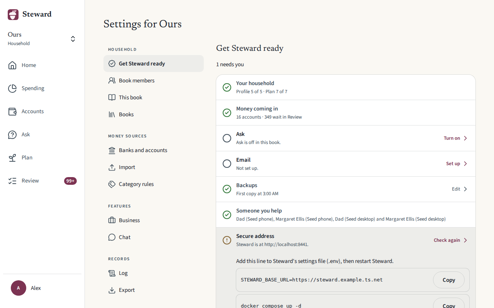

# Choose how to reach Steward

Read this when you want to open Steward from a phone or another computer, or to change how you do.

Every way in except the machine Steward runs on needs HTTPS, because passkeys and the sign-in cookie require it. Out of the box Steward answers only on this machine, at `http://localhost:8420`, and reaching it from anywhere else is a choice you make. [S13](../CLAIMS.md#s13)

You pick one way in with `COMPOSE_PROFILES` in `.env`, and set `STEWARD_BASE_URL` to the address people will type. Pick the address first (see [Passkeys and the address](#passkeys-and-the-address)).

Settings › Get Steward ready checks the address for you. When it needs a change, its Secure address row shows the line to add to `.env`.

## Tailscale

Recommended. Steward is reachable on your tailnet and nowhere else.

1. In your tailnet's admin console, turn on MagicDNS and HTTPS certificates.
2. Make an auth key at login.tailscale.com/admin/settings/keys.
3. In the deploy folder, run `cp tailscale/tailscale.env.example tailscale.env && chmod 600 tailscale.env`, and put the key on the `TS_AUTHKEY=` line. End the file with a line break.
4. In `.env`, set `COMPOSE_PROFILES=tailscale` and `STEWARD_BASE_URL=https://steward.<your tailnet>.ts.net`.
5. Run `docker compose up -d`, then open that address.

The key is used once. After the first sign-in the machine's identity is kept in the `tailscale-state` volume, and the `TS_AUTHKEY=` line can go.

## Your own domain

Steward answers at a name you own, through the bundled proxy.

1. In the deploy folder, run `cp proxy/proxy.env.example proxy.env && chmod 600 proxy.env`.
2. In `proxy.env`, set `STEWARD_DOMAIN` to the name, with no `https://` and no port.
3. Set `STEWARD_TLS` to say how Caddy proves the name is yours.
   - `dns-cloudflare` works for a private address. Put a Cloudflare API token in `CLOUDFLARE_API_TOKEN`, limited to Zone Read and DNS Edit on that domain's zone.
   - `http` needs ports 80 and 443 open to the internet. With `http`, Steward is on the internet, so anyone can reach its sign-in page.
4. In `.env`, set `COMPOSE_PROFILES=domain` and `STEWARD_BASE_URL=https://<the name>`.
5. `STEWARD_PROXY_BIND` is the address the proxy listens on. It is `127.0.0.1` until you set this machine's LAN address, which a domain that points at a private address needs.
6. Run `docker compose up -d`.

## LAN only

HTTPS on your own network, with a certificate from Caddy's own authority. Each phone and computer must trust Caddy's root certificate once. These steps replace the Tailscale parts of the quick start's steps 2 and 3; you still make the data folder (step 3) and the setup link (step 4) there.

1. Give this machine a name that every device on your network finds. An IP address doesn't work: a browser sends no name for an address, so Caddy can't choose the certificate and the browser shows `ERR_SSL_PROTOCOL_ERROR`, and passkeys need a name too. The proxy refuses to start with one and says so in `docker compose logs proxy-lan`. Pick one of these, using this machine's address on your network, such as `192.168.1.20`.
   - Your router. Many routers let you add a local DNS name, or give a name to a device they hand an address to. Phones and computers alike find it, and nothing leaves your network.
   - A line in each computer's hosts file. On Linux and macOS, run `echo '192.168.1.20 steward.lan' | sudo tee -a /etc/hosts`. On Windows, open Notepad as administrator, open `C:\Windows\System32\drivers\etc\hosts`, add the line `192.168.1.20 steward.lan` and save. Phones have no hosts file.
   - `192.168.1.20.nip.io`, with no setup. nip.io is a public DNS service that answers any name like this with the address inside it. Each device asks it for the name, so the service sees your private address; Steward's own traffic never goes through it. Some routers refuse such answers, and then the name doesn't resolve.

   From another device, `ping` the name. It should answer from this machine's address before you go on.
2. In the deploy folder, run `cp proxy/proxy.env.example proxy.env && chmod 600 proxy.env`, and in `proxy.env` set `STEWARD_DOMAIN` to the name, such as `steward.lan`.
3. In `.env`, set `COMPOSE_PROFILES=lan`, `STEWARD_BASE_URL=https://<the name>`, such as `https://steward.lan`, and `STEWARD_PROXY_BIND` to this machine's address, such as `192.168.1.20`.
4. Run `docker compose up -d` (the quick start's step 5). Caddy makes its root certificate at the first start.
5. Copy the root out of the proxy with `docker compose cp proxy-lan:/data/caddy/pki/authorities/local/root.crt root.crt`. Then get `root.crt` to each device. From a computer, run `scp <you>@192.168.1.20:steward/deploy/root.crt .`, with your user on this machine and the path to its deploy folder. For a phone, send the file to yourself, or serve it for a minute: run `python3 -m http.server 8000 --bind 192.168.1.20` in a folder that holds only `root.crt`, open `http://192.168.1.20:8000/root.crt` on the phone, then stop it with Ctrl+C. The file is the certificate only; its key stays in the proxy.
6. Trust `root.crt` on each device.
   - iOS. Send the file to the device and open it, then install the profile in Settings. Turn it on under Settings › General › About › Certificate Trust Settings.
   - Android. Open Settings, search for "CA certificate" and install the file. Some versions place it under Security › Encryption and credentials › Install a certificate.
   - macOS. Open the file in Keychain Access, then set it to Always Trust.
   - Windows. Open the file, choose Install Certificate, and place it in Trusted Root Certification Authorities.
   - Linux. On Debian and Ubuntu, run `sudo cp root.crt /usr/local/share/ca-certificates/steward.crt && sudo update-ca-certificates`. Chrome and Chromium keep their own list: run `certutil -d sql:$HOME/.pki/nssdb -A -t "C,," -n steward -i root.crt` (from the `libnss3-tools` package). Firefox keeps its own too: Settings › Privacy & Security › View Certificates › Authorities › Import. Restart the browser.

Until a device trusts the root, its browser warns about the certificate, and passkeys don't work there even if you continue past the warning. Get Steward ready's Secure address row says so when the browser refuses passkeys there.

The root and its key stay in the `caddy-data` volume. Anyone who trusts the root trusts every certificate that Caddy signs, so keep the file to your own devices.

## On this machine only

Open `http://localhost:8420` on the machine that runs Steward. Leave `COMPOSE_PROFILES` out of `.env` and set `STEWARD_BASE_URL=http://localhost:8420`. Passkeys work here because browsers treat `localhost` as secure. Nothing else on your network can connect.

## Passkeys and the address

Passkeys are tied to the hostname in `STEWARD_BASE_URL`. Choose the address before anyone registers a passkey. If it changes later, for example a new tailnet name, existing passkeys stop working and each person adds their device again from the You menu › Sign-in and devices.

`STEWARD_BASE_URL` must match the browser's address exactly, including the port if there is one. If every passkey attempt says "That passkey couldn't be checked", compare the two.

Give each Steward its own hostname. Browsers tie passkeys to the hostname and ignore the port, so two Stewards at one name, such as the demo and an install both at `localhost`, look like one site to the device. Each offers the other's passkeys, picking the other's passkey makes the device forget it, and removing a passkey in one can make the device drop the other's.

Steward counts the tries a device makes by the address it sees. Behind a proxy that address is the proxy's unless Steward believes the proxy's forwarded headers, which `STEWARD_TRUSTED_PROXIES` decides. The default covers Tailscale and the bundled proxy. If a proxy hands Steward one address for every connection, the limits count for the whole household. If Steward's port is reachable from a LAN, narrow `STEWARD_TRUSTED_PROXIES` to the proxy's address, or anyone on that LAN can claim any address.

See [configuration](../reference/configuration.md#stewards-settings) for every setting, and [ports and volumes](../reference/ports-and-volumes.md) for what each way in opens.
