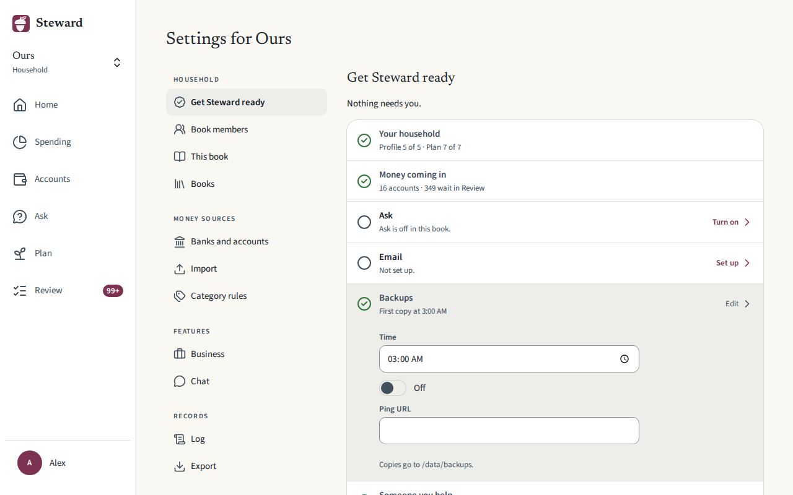

# Backups and restore

Read this to keep copies of your books, to check that they restore, and to bring one back.

## The daily backup

Steward backs itself up every day at `STEWARD_BACKUP_AT`, which is `03:00` in your time zone. Each run writes an encrypted copy of the directory and of every book, and keeps the 14 newest of each. Setting `STEWARD_BACKUP_AT=` to an empty value turns it off. You can also change the time in Settings › Get Steward ready, on the Backups row.



1. Put the backups on another disk. Uncomment the backups mount in `compose.yml`, pointing at a folder on that disk, and set `STEWARD_BACKUP_DIR=/backups` in `.env`.
2. Optional. Set `STEWARD_BACKUP_PING_URL` to a Healthchecks-style address. Steward fetches it after each good backup, and `<address>/fail` after a bad one, so a missed night alerts you. Keep the address private, because anyone who has it can mark the check up or down.
3. Run `docker compose up -d`. `docker compose logs steward` shows a `Backups:` line that says when the next one runs.

Backups never hold the encryption key, so a backup alone opens nothing. Keep the key somewhere safe (see [the encryption key](encryption-key.md)). [S2](../CLAIMS.md#s2)

## Back up now

```
docker compose exec steward steward backup
```

This writes `steward-directory-YYYYMMDD-HHMMSS.db` and `steward-<slug>-YYYYMMDD-HHMMSS.db` for each book. A book's uploaded files are copied, still encrypted, into `steward-<slug>-files/`. A file removed in the app keeps its copy there for 14 days.

## Check that they restore

```
docker compose exec steward steward restore-check
```

It opens each copy in a scratch folder. Each must open with the key, pass SQLite's integrity check, be at the current schema and hold transactions if its book does, and every uploaded file must decrypt. It prints one line per book and exits 1 if anything fails. It never prints a key, an amount or a file's name, and it never writes to your live books.

## Restore one book or the directory by hand

Use this when a book is damaged or you are rebuilding.

1. Stop Steward with `docker compose stop steward`.
2. Pick the copy. The newest has the latest stamp in its name.
3. For a book, copy `steward-<slug>-YYYYMMDD-HHMMSS.db` over `data/books/<slug>/book.db`. For the directory, copy `steward-directory-YYYYMMDD-HHMMSS.db` over `data/directory.db`. The first book, `ours`, is `data/steward.db`.
4. Keep the book's files folder. To bring back one file, copy it from `steward-<slug>-files/<id>` to `data/books/<slug>/files/<id>`. Skip any file ending `.gone`.
5. Make the copies Steward's own with `sudo chown -R 1000:1000 data`.
6. Start Steward with `docker compose start steward` and run `steward restore-check`.

Take every copy for one restore from the same run, so the directory and the books agree.

## Restore from an export

An encrypted export made in Settings › Export opens only with the passphrase chosen when it was made, and Steward cannot recover a lost one. It restores as a new book, never over an existing one.

```
docker compose exec steward steward restore-from-export /data/<the export>.steward-backup --name "Restored"
```

Copy the file into the data folder first. The command asks for the passphrase at a prompt. Bank links are not carried over, so link the bank again. See [commands](../reference/commands.md#steward-restore-from-export).
