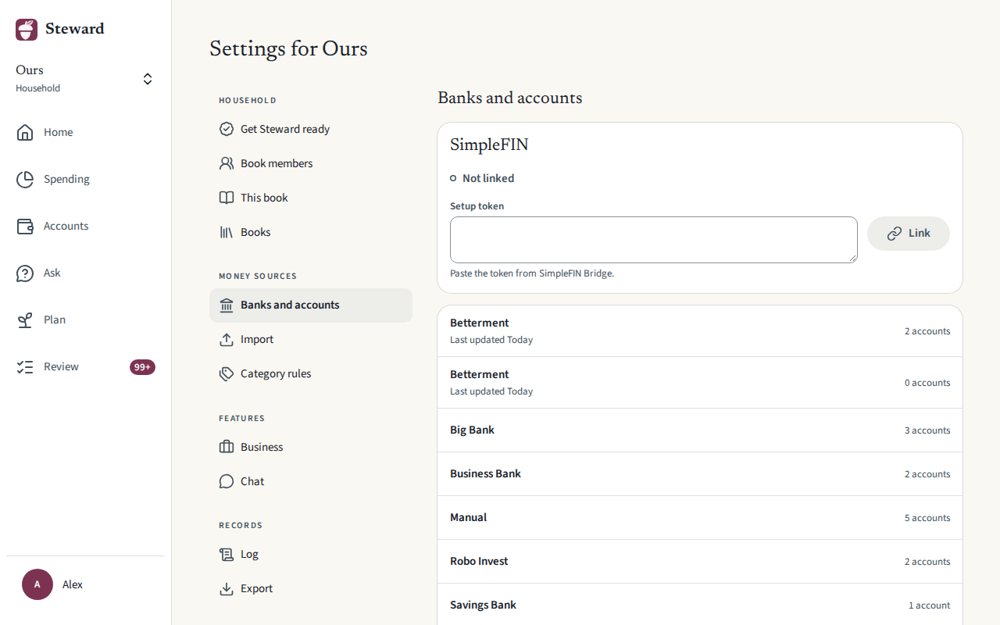

# Connect your bank or import files

Read this to get transactions into a book. You can connect a bank feed, import files, or do both. Files alone are a full way to run Steward.

## Connect a bank with SimpleFIN

SimpleFIN Bridge is a paid third-party service, about $15 a year, that lets Steward read your accounts.

1. Subscribe at SimpleFIN Bridge, connect your banks there, and make a setup token.
2. In Steward, open Settings › Banks and accounts and paste the token. Steward claims it, stores the access address and runs a first sync.

   
3. After that it syncs every `STEWARD_SYNC_HOURS` hours, which is 6 unless you change it. Set it to `0` to turn automatic sync off. To sync now, run `docker compose exec steward steward sync`.

Unlinking removes the link and keeps the accounts and transactions already pulled.

### The same account through two logins

SimpleFIN gives each connection its own ids, so a bank removed and added again, or a joint account under a second person's login, can arrive twice. When a new account looks like one you already have, Steward holds it and asks "Same account?" on Home. Nothing is counted until a manager answers.

- Merge them drops the copies and keeps anything new. The account then takes updates from both logins.
- They're different adds it as a new account with its history.

Either choice can be undone for 15 minutes.

## Import files

Open Settings › Import and choose a file. Then choose the account it belongs to, or New account…, which asks for the account's type and its balance today. Then Preview, then Import. Steward reads these.

- Chase credit card CSV and Chase checking CSV.
- Other CSV, where you choose the date, description and amount columns. Use this for any bank without its own format.
- OFX and QFX, the files Quicken reads. Try this first for Marcus, Betterment and Empower.
- PDF statements. Steward opens them in a sandbox, never unconfined. If the machine cannot confine the sandbox, the statement waits instead. [S6](../CLAIMS.md#s6)
- A positions CSV, for the holdings in an investment account.

An imported row waits in Review for one of these reasons, and the import's line says how many of each, for example "3 rows in. 1 to sort in Review."

- To sort: neither a rule of yours, Steward's built-in rules, nor the gateway's local model (if you have one) gave the row a category. Payments through Zelle, Venmo, Cash App or PayPal wait here unless a rule of yours matches them, because they don't say what they were for. Choose the category in Review. This is the usual reason after a first import, before you have rules.
- Possible duplicate: the row has the same amount and description as one in the same account within 2 days. Review shows the two together, and you keep both or remove the imported one.

With a business set up, Review also asks "business or personal" about money out that the local model thinks is likely business.

See [commands](../reference/commands.md#steward-sync) for `steward sync` and [configuration](../reference/configuration.md#stewards-settings) for `STEWARD_SYNC_HOURS`.
