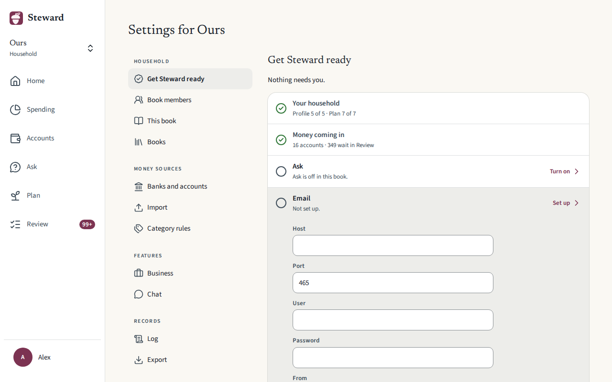

# Set up email

Read this when you want Steward to send mail. Without email everything else works, and flags still show in the app.

Steward sends password reset links, invites to a book and Watching alerts. It has no emailed sign-in.

## In Steward

1. Open Settings › Get Steward ready and find the email row.
2. Enter your mail server's host and port. Use port 465 for TLS, or 587 for STARTTLS.
3. Enter the user, the password and the address Steward sends from, such as `"Steward" <noreply@example.com>`.
4. Choose Send a test. The test goes to you, and Steward says whether the server took it.



Email is on only when the host, user, password and from address are all set. The password is never shown again once you save it, so keep it in your password manager. [S9](../CLAIMS.md#s9)

## In `.env`

The same settings can go in `.env`, which wins over the app even when a line is empty.

```
STEWARD_SMTP_HOST=smtp.example.com
STEWARD_SMTP_PORT=465
STEWARD_SMTP_USER=steward
STEWARD_SMTP_PASSWORD=
STEWARD_MAIL_FROM="Steward" <noreply@example.com>
```

Set all four of host, user, password and from, or none. Restart Steward with `docker compose up -d` after you change `.env`.

## What the emails say

Emails give amounts, payee and account names, and a link. They never show an account number. [P15](../CLAIMS.md#p15)

A Watching alert that fails to send is tried three times, 30 minutes apart, then noted in the book's log. The flag stays open either way.

See [configuration](../reference/configuration.md#stewards-settings) for each setting.
