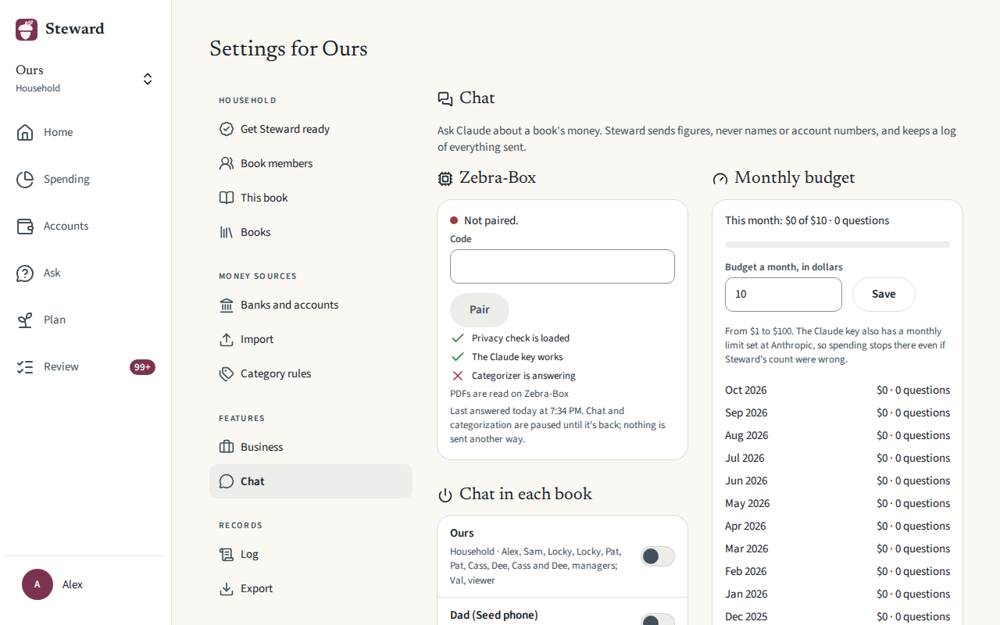

# Pair the gateway and Ask Claude

The gateway is the only part of Steward that talks to Claude. It checks each question for names and other identifying details before anything leaves, and it holds the Anthropic API key. It's optional.

Choose where it runs, then follow the steps in that section, then [add the key](#the-claude-api-key) and [pair it](#pairing). You need an Anthropic account with an API key.

## What the gateway does

Steward never connects to Claude itself. Only your gateway does. [P14](../CLAIMS.md#p14) The gateway does four jobs:

1. It checks each question for names and other identifying details, and sends Claude only the checked question.
2. It runs the model pass: small models on your own hardware sort new transactions into categories and write short chat titles.
3. It reads statement PDFs for Steward, as a second PDF reader, when Steward's own machine can't confine the sandbox. This includes scanned pages and layouts Steward hasn't seen.
4. It holds the Anthropic API key.

You can run Steward without it. The next section shows what you give up.

## What works without it

| | No gateway | Gateway, no local model | Gateway with a local model |
|---|---|---|---|
| Spending, Accounts, Review, Plan, Taxes, Watching, Books, email | yes | yes | yes |
| CSV, OFX/QFX and positions imports | yes | yes | yes |
| Text PDF statements | yes, if this box can confine the PDF sandbox; otherwise they wait | yes, when the gateway can confine its sandbox (see Reading PDFs) | yes, when the gateway can confine its sandbox (see Reading PDFs) |
| Scanned PDFs, new layouts | no | no | yes |
| Ask (Claude) | no | yes | yes |
| Categorizing | your rules and Review | your rules and Review | the local model, then Review |
| Chat titles | the question's first six words | the question's first six words | a short title from the local model |

With no local model, the gateway says so when it starts:

```
Local model: none yet. Ollama isn't answering at http://ollama:11434, so categorizing, chat titles, scanned pages and new statement layouts wait. Ask doesn't need it.
```

Steward sorts new rows with your rules and Review, keeps the question's first six words as a chat's title, and holds scanned statements and new statement layouts until a local model answers. Such a statement's line in Settings › Import says it needs a local model on the gateway.

## On the same box, with compose

1. In `.env`, add `gateway` and `ollama` to the way in that `COMPOSE_PROFILES` already names, such as `COMPOSE_PROFILES=tailscale,gateway,ollama` or, for LAN only, `COMPOSE_PROFILES=lan,gateway,ollama` (leave out `ollama` for no local model). Then uncomment `STEWARD_GATEWAY_URL=http://gateway:8430`.
2. Give the gateway the key (see The Claude API key).
3. Run `docker compose up -d`. The first start downloads the redaction model from Hugging Face, pinned to one commit. `docker compose ps` shows the gateway as healthy when it's ready. Its log then has a few warnings from the libraries it uses. One says the tokenizer has "an incorrect regex pattern" and to set `fix_mistral_regex=True`. That one is expected: the check is meant for a different family of models, and the tokenizer loads unchanged, as the redaction tests measured it. Don't set the flag; it would change how names are read.
4. Pair it (see Pairing).
5. For a local model, run `docker compose logs gateway` to see what to pull, then for example `docker compose exec ollama ollama pull qwen3.5:9b-q4_K_M`. Steward notices within a minute.

### How it stays private

- The gateway publishes no port. Steward reaches it at `http://gateway:8430` on `gateway-private`, a network with no way out, and only the gateway and Ollama join `gateway-egress`, the way out to Claude and Hugging Face. [S12](../CLAIMS.md#s12)
- The names `gateway` and `ollama` are answered only inside Compose, never by your network's DNS, so with no `ollama` service nothing is sent anywhere. [S12](../CLAIMS.md#s12)
- Its `gateway.toml` says `network = "compose"`, which works only inside a container. On a machine of its own, the gateway listens only on Tailscale or 127.0.0.1. [S12](../CLAIMS.md#s12)
- The key, the pairing token and the history key live in the `gateway-config` volume, readable only by the gateway's own user.

### Changing a setting

The image copies its `gateway.toml` into the volume once, and later images leave your copy alone. To change it:

```
docker compose cp gateway:/etc/steward-gateway/gateway.toml gateway.toml
```

Edit `gateway.toml`, then put it back and restart:

```
docker compose cp gateway.toml gateway:/etc/steward-gateway/gateway.toml
docker compose restart gateway
```

### Speed on CPU

The image runs redaction on the CPU. These numbers come from `steward-gateway eval redaction` in the gateway image, limited to 4 CPUs and 4 threads (`docker run --cpus 4`), on 2026-11-09, on a 12th-generation Intel Core i9 held to 4 CPUs.

| One read | p50 | p95 |
|---|---|---|
| A question (38 fictional questions) | 84 ms | 100 ms |
| 1,000 characters | 315 ms | 345 ms |

A turn reads the question three times before it's sent (the preview, the turn and the check) and each tool result once, so the question's share of a turn is about 250 ms. A 4-CPU limit on a faster machine isn't an older 4-core box, which may take longer.

To time your own box:

```
docker compose run --rm --no-deps gateway steward-gateway eval redaction
```

Its first line says how many threads it used. The gateway doesn't set the number: PyTorch picks it from the CPUs it sees, usually one per physical core, so a virtual machine with 4 CPUs that are 2 cores can get 2 threads and read about half as fast as the table. To time it with 4 threads, add `-e OMP_NUM_THREADS=4` after `run`.

To go faster, see [Speed up the gateway with a GPU](gpu.md).

## On another machine on your tailnet

Use this when you want a GPU for the local models, or want the gateway off the machine that holds your books. The gateway runs on a Linux machine of its own that is on your tailnet, and Steward reaches it over Tailscale. You need Linux with systemd, [uv](https://docs.astral.sh/uv/), git and Tailscale, and a GPU if you have one. The gateway also runs on a CPU.

The gateway uses its own account, so that nothing you run as yourself can read its API key or pairing token. Its files are in three folders that only that account can open.

| Folder | What is in it |
|---|---|
| `/etc/steward-gateway` | `gateway.toml`, `gateway.env` (the key), the pairing token and the history key |
| `/var/lib/steward-gateway` | the ledger of what was sent to Claude, the pairing request and the stop-chat flag |
| `/var/cache/steward-gateway` | the redaction model, fetched pinned to one commit |

1. Create the account and its folders:

   ```
   sudo useradd --system --user-group --home-dir /var/lib/steward-gateway --no-create-home --shell /usr/sbin/nologin steward-gw
   sudo install -d -m 700 -o steward-gw -g steward-gw /etc/steward-gateway /var/lib/steward-gateway /var/cache/steward-gateway
   ```

2. Get the code, owned by root so the gateway's account can run it but not change it:

   ```
   sudo git clone https://github.com/steward-money/steward.git /opt/steward-gateway
   cd /opt/steward-gateway && sudo uv sync --frozen --no-dev --group gateway --group models
   ```

   For a machine with no GPU, expect a large download. The `models` group brings in PyTorch.

3. Run `tailscale ip -4` and note the address, which starts with `100.`. Write the gateway's settings, with that address as `host`. The gateway refuses any address outside Tailscale's range, except 127.0.0.1. [S12](../CLAIMS.md#s12)

   ```
   sudo -u steward-gw tee /etc/steward-gateway/gateway.toml <<'EOF'
   host = "100.x.y.z"
   port = 8430
   timezone = "America/Chicago"
   EOF
   ```

   Use your own time zone. The monthly budget starts at midnight in it. [Configuration](../reference/configuration.md#gatewaytoml) lists the other settings.

4. Add the key (see [The Claude API key](#the-claude-api-key)).

5. Install the service. Save this as `/etc/systemd/system/steward-gateway.service`:

   ```
   [Unit]
   Description=Steward gateway
   After=network-online.target
   Wants=network-online.target

   [Service]
   User=steward-gw
   Group=steward-gw
   WorkingDirectory=/var/lib/steward-gateway
   ExecStart=/opt/steward-gateway/.venv/bin/steward-gateway serve
   Restart=on-failure
   RestartSec=5
   Environment=STEWARD_GATEWAY_CONFIG_DIR=/etc/steward-gateway
   Environment=STEWARD_GATEWAY_STATE_DIR=/var/lib/steward-gateway
   Environment=HF_HOME=/var/cache/steward-gateway
   Environment=XDG_CACHE_HOME=/var/cache/steward-gateway
   Environment=HF_HUB_DISABLE_TELEMETRY=1
   ReadWritePaths=/etc/steward-gateway /var/lib/steward-gateway /var/cache/steward-gateway
   UMask=0077
   NoNewPrivileges=yes
   ProtectSystem=strict
   ProtectHome=yes
   PrivateTmp=yes

   [Install]
   WantedBy=multi-user.target
   ```

   Then run `sudo systemctl daemon-reload && sudo systemctl enable --now steward-gateway`. The first start downloads the redaction model, pinned to one commit, which takes a few minutes.

6. Make a small wrapper so each command runs as the gateway's account. Save this as `/usr/local/bin/steward-gateway` and make it executable with `sudo chmod 755 /usr/local/bin/steward-gateway`:

   ```
   #!/bin/sh
   exec sudo -k -u steward-gw env STEWARD_GATEWAY_CONFIG_DIR=/etc/steward-gateway STEWARD_GATEWAY_STATE_DIR=/var/lib/steward-gateway HF_HOME=/var/cache/steward-gateway /opt/steward-gateway/.venv/bin/steward-gateway "$@"
   ```

   It asks for your password each time and remembers nothing. Run `steward-gateway check` to confirm the key works.

7. Let only Steward reach port 8430. In your tailnet's access controls, tag the gateway machine, for example `tag:gateway`, tag the machine Steward runs on, for example `tag:steward`, and add a grant such as:

   ```
   {"src": ["tag:steward"], "dst": ["tag:gateway"], "ip": ["tcp:8430"]}
   ```

   With no other grant to `tag:gateway`, nothing else on your tailnet reaches the gateway. If your policy allows everything between your own machines, remove that rule for the gateway.

8. In Steward's `.env`, uncomment `STEWARD_GATEWAY_URL` and set it to `http://100.x.y.z:8430`, using the gateway's full MagicDNS name or its `100.` address. Steward in compose doesn't resolve short names, so `http://gateway-box:8430` won't work. Run `docker compose up -d`, then [pair it](#pairing).

For a local model, install [Ollama](https://ollama.com) on the gateway machine, keep it on `127.0.0.1:11434` (`OLLAMA_HOST=127.0.0.1:11434`) and pull a model from [Models and their licenses](#models-and-their-licenses). The gateway looks for Ollama there by default. A GPU makes this much faster.

To update, go to `/opt/steward-gateway`, run `sudo git pull --ff-only` and `sudo uv sync --frozen --no-dev --group gateway --group models`, then `sudo systemctl restart steward-gateway`.

## The Claude API key

The key lives in `gateway.env` in the gateway's config folder, never in Steward. It never passes through Steward.

On a machine of its own, write it as the gateway's account, so no copy is left under yours:

```
sudo install -m 600 -o steward-gw -g steward-gw /dev/null /etc/steward-gateway/gateway.env
sudo -u steward-gw bash -c 'umask 077; read -rsp "Paste the key: " KEY; echo; printf "ANTHROPIC_API_KEY=%s\n" "$KEY" > /etc/steward-gateway/gateway.env'
```

In compose, set it with:

```
docker compose run --rm --no-deps gateway bash -c 'umask 077; read -rsp "Paste the key: " KEY; echo; printf "ANTHROPIC_API_KEY=%s\n" "$KEY" > /etc/steward-gateway/gateway.env'
```

It asks for the key so the key never lands in shell history. From a script, or over SSH with no terminal, give the key on standard input instead, from a file that holds only the key or from a password manager's command line through a pipe:

```
docker compose run --rm --no-deps -T gateway bash -c 'umask 077; read -r KEY; printf "ANTHROPIC_API_KEY=%s\n" "$KEY" > /etc/steward-gateway/gateway.env' < key.txt
```

Then delete `key.txt`. Either way the key never appears on a command line.

Set a monthly spend limit for the key in the Anthropic console, then run:

```
docker compose run --rm --no-deps gateway steward-gateway check
```

## Pairing



1. On the gateway, run `docker compose exec gateway steward-gateway pair`. On a machine of its own, run `steward-gateway pair`.
2. Type the code it shows in Steward, under Settings › Get Steward ready › Ask or Settings › Chat. It works for 10 minutes and 5 tries. [S10](../CLAIMS.md#s10)

To start from Steward's side instead, run `steward advisor pair`. It prints a code, and you give that code to `steward-gateway pair` on the gateway within 10 minutes.

## Models and their licenses

The gateway uses three models, and none of them is part of Steward.

- Qwen, which sorts transactions and writes chat titles through Ollama. The default is `qwen3.5:9b-q4_K_M`, released under Apache-2.0.
- Gemma, which reads scanned statement pages. Google publishes it under its own terms, the [Gemma Terms of Use](https://ai.google.dev/gemma/terms). Read them on the model's page for the version you pull. The default is `gemma4:12b-it-qat`.
- GLiNER-PII, which finds names and other identifying details in your question before it leaves. It runs inside the gateway and is released under Apache-2.0.

Pull the Ollama models you want, for example `ollama pull qwen3.5:9b-q4_K_M`. Only the `-q4_K_M` and `-it-qat` builds work. To check that a model sorts well enough on your hardware, run `steward-gateway eval categorizer`. Add `--model NAME` for each model to compare. It shows one line per model, with `ok` when the model is accurate and fast enough. The [commands reference](../reference/commands.md#steward-gateway-eval-categorizer) lists the options.

## Reading PDFs

`docker compose exec gateway steward-gateway pdf-check` tells you whether the gateway opens statement PDFs. On a machine of its own, run `steward-gateway pdf-check`.

On the machine this was tried on, it does: the gateway's container confines its PDF sandbox under Docker's default settings. If yours doesn't, text PDFs wait in Steward until the release's security review settles the narrowest setting that lets the sandbox work. Don't loosen the container's seccomp profile to get around it.

## Advanced: Claude Code

Claude Code can look up a book's figures through the gateway. Steward checks what its tools return the way it checks Ask's. What you type into Claude Code doesn't pass through Steward, so names you type there are sent as typed and aren't in the book's log. Claude Code's door on the gateway is off unless `gateway.toml` says `mcp = true`. [S15](../CLAIMS.md#s15) With it off, nothing listens on its port and `steward-gateway mcp-grant add` refuses.

Turn it on only if you use Claude Code on the gateway machine. Once it's on, anything that runs as you on that machine and can read Claude Code's settings can run every lookup a grant allows. What it gets is what Ask would send: aliases and figures, no store or payee names, and each result is written to the book's log. It isn't available in the compose install, which refuses `mcp = true`.

1. On the gateway machine, set `mcp = true` in `/etc/steward-gateway/gateway.toml`, and set `nas_url` to Steward's address, like `https://steward.<your tailnet>.ts.net`. Restart the gateway.
2. In Steward, a manager opens Settings › Chat › Claude Code and taps Issue a grant. Steward shows it once.
3. In a plain terminal on the gateway machine, not through Claude Code, run `steward-gateway mcp-grant add` and paste the grant when it asks. It prints a `claude mcp add` command.
4. Run that command where you use Claude Code. In Claude Code, `/mcp` lists the connection.

A grant lasts 30 days. Revoke it in Settings › Chat at any time, then run `steward-gateway mcp-grant remove NAME`. `steward-gateway stop-chat` stops Claude Code's lookups too.
