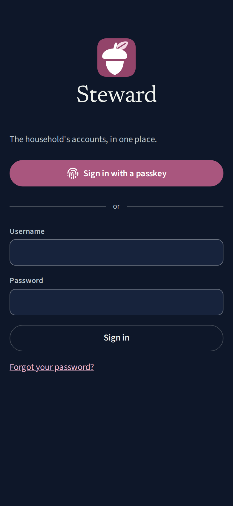
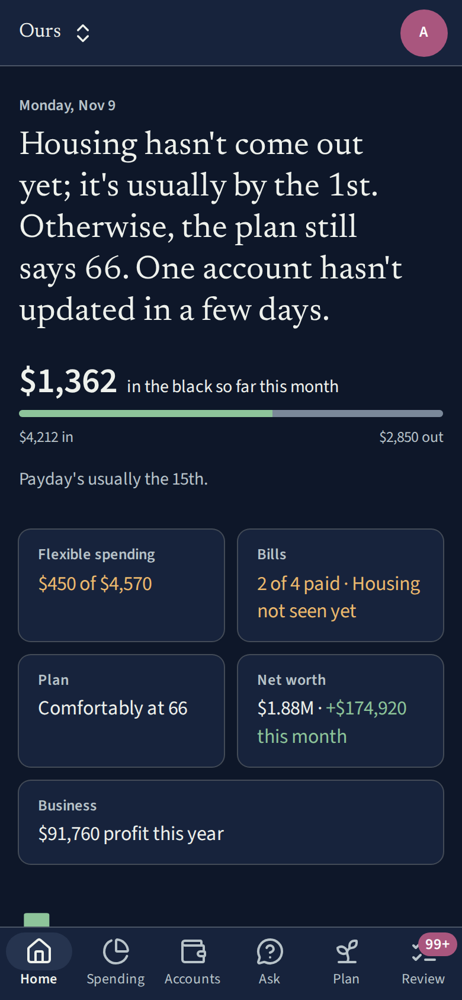

# Try the demo in 5 minutes

This runs a made-up household on your own machine, with nothing connected to it. You need Docker with Compose 2.24 or newer.

1. Get the code and go to the deploy folder.

   ```
   git clone https://github.com/steward-money/steward
   cd steward/deploy
   ```

2. Start the demo.

   ```
   docker compose -f compose.demo.yml up
   ```

   The demo answers on port 8420, the same port as an installed Steward. If Steward is already running on this machine, stop it first, or give the demo another port and use that port in the next step:

   ```
   STEWARD_DEMO_PORT=8425 docker compose -f compose.demo.yml up
   ```

3. Open `http://localhost:8420` and sign in as Alex with the username `alex` and the password `pw-demo-alex-2026`. Sam's login is `spouse` and `pw-demo-spouse-2026`.

   `localhost` means a browser on the machine that runs Docker. The demo answers only there. [S13](../CLAIMS.md#s13) If Docker runs on another machine, such as a home server, first forward the port from the computer you browse on, then open the same address there:

   ```
   ssh -L 8420:127.0.0.1:8420 you@that-machine
   ```

   

4. Look around. Home shows where the household stands, Review lists the transactions that need a decision, and Plan looks ahead.

   

5. When you are done, remove the demo and everything it made.

   ```
   docker compose -f compose.demo.yml down -v
   ```

The demo is only for looking. A real install refuses to start while a demo sign-in is left in its books. [S14](../CLAIMS.md#s14)

## What you have now

You have seen Steward with a household's worth of made-up data, and then removed it.

- To run it for your own household, follow [Install for your household](install.md).
- To find any other page, start from [Steward's docs](../README.md).
