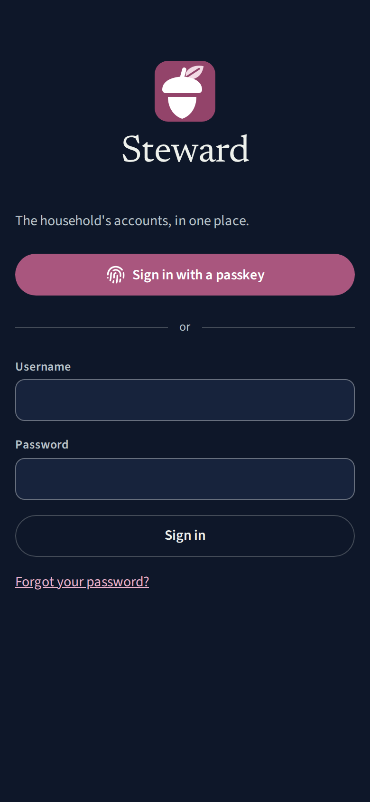
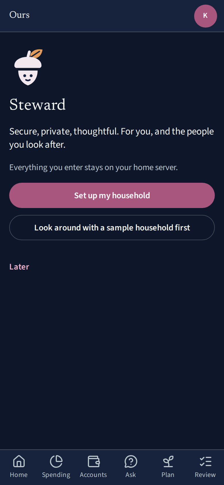
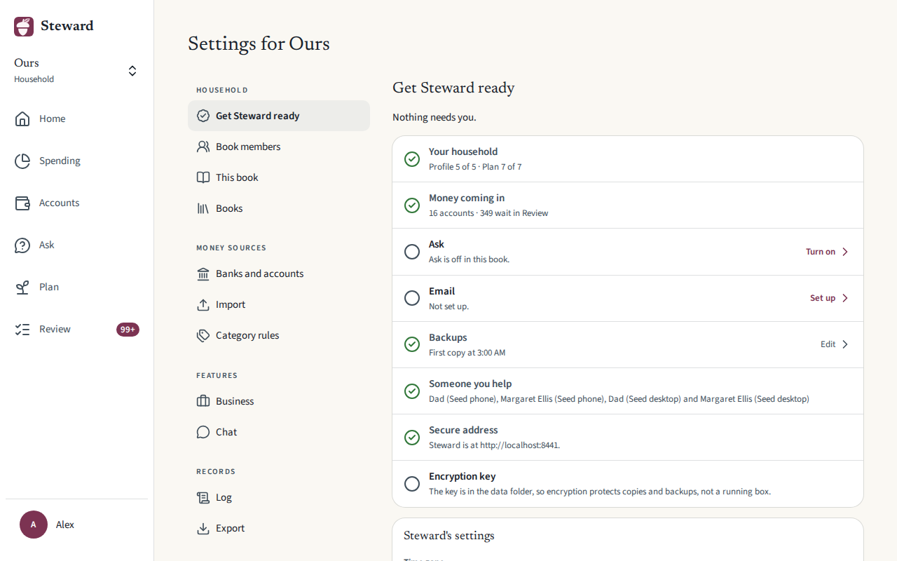
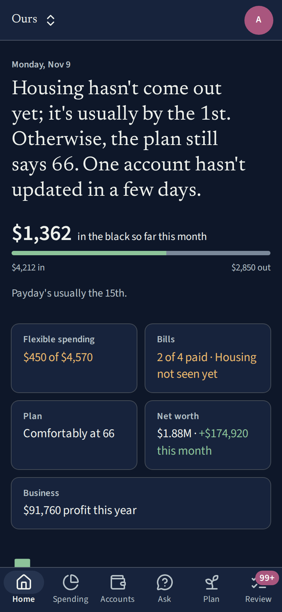

# Install for your household

This is the shortest safe path: Steward on your own machine, reached over Tailscale. You need an x86_64 Linux machine with Docker Engine 24 or newer and Docker Compose 2.24 or newer (`docker compose version` shows it), 2 GB of RAM (4 GB more if you add the gateway for Ask) and a Tailscale account. Podman isn't supported yet.

No Tailscale? Use [LAN only](../guides/access.md#lan-only) instead. Its steps 1 to 3 replace the Tailscale settings in step 2 and the Tailscale half of step 3 here, and after step 5 you trust its certificate on each device (its steps 5 and 6). Every other step stays the same.

1. Get the code and go to the deploy folder.

   ```
   git clone https://github.com/steward-money/steward
   cd steward/deploy
   ```

2. Make your settings file.

   ```
   cp .env.example .env && chmod 600 .env
   ```

   In `.env`, set `STEWARD_BASE_URL=https://steward.<your tailnet>.ts.net` and `COMPOSE_PROFILES=tailscale`. For LAN only, do steps 1 to 3 of LAN only instead.

3. Make the data folder. Steward runs as user 1000 and keeps everything in it.

   ```
   mkdir -p data && sudo chown 1000:1000 data
   ```

   With Tailscale: in your tailnet's admin console, turn on MagicDNS and HTTPS certificates. Then make Tailscale's settings file and put an auth key from login.tailscale.com/admin/settings/keys on its `TS_AUTHKEY=` line.

   ```
   cp tailscale/tailscale.env.example tailscale.env && chmod 600 tailscale.env
   ```

4. Make the first account's setup link.

   ```
   docker compose run --rm steward steward setup
   ```

   The link works once, for 30 minutes. If it runs out before you open it, for instance while you trust the certificate on the LAN only path, run the same command again for a new one. It's safe to run while Steward is up, and it closes the old link.

5. Start Steward.

   ```
   docker compose up -d
   ```

6. On a phone or computer that can reach the address, open the one-time link that `steward setup` printed, within 30 minutes (or make a new one, as in step 4). Make your account with your name, a username, an email address and a password of at least 12 characters. There is no open sign-up, so only someone with that link can make the first account. [S7](../CLAIMS.md#s7) Steward may offer to add a passkey for this device. Choose Add a passkey or Not now; you can add one later from the You menu › Sign-in and devices. Then you are signed in. Next time, you sign in on this page.

   

7. The first run opens on a welcome. Choose Set up my household. It walks you through Bring in your money, Sort a few and A few extras. Take as much of it as you like now. Choose Later, under the card, to leave the welcome; until you finish it or choose Later, Home brings you back to it.

   

8. Open the You menu (the button with your name) and choose Settings for &lt;your book's name&gt;, such as Settings for Ours, then Get Steward ready. It lists what is left to set up, such as backups and email.

   

9. Choose Home in the menu.

   

Until you choose a way in, Steward answers only on the machine it runs on, at `http://localhost:8420`. [S13](../CLAIMS.md#s13)

## What you have now

You have a running Steward with your own account, reachable over your tailnet or your own network.

Next:

- [Set up email](../guides/email.md) so Steward can send password reset links and invitations.
- [Back up your books](../guides/backups.md) to another disk.
- [Connect your bank or import files](../guides/bank-data.md).
- [Keep the encryption key safe](../guides/encryption-key.md).
- [Pair the gateway and Ask Claude](../guides/gateway.md), on this machine with compose or on another machine on your tailnet. With a GPU, [speed it up](../guides/gpu.md).
- [If you are locked out](../reference/commands.md#steward-reset-password).
